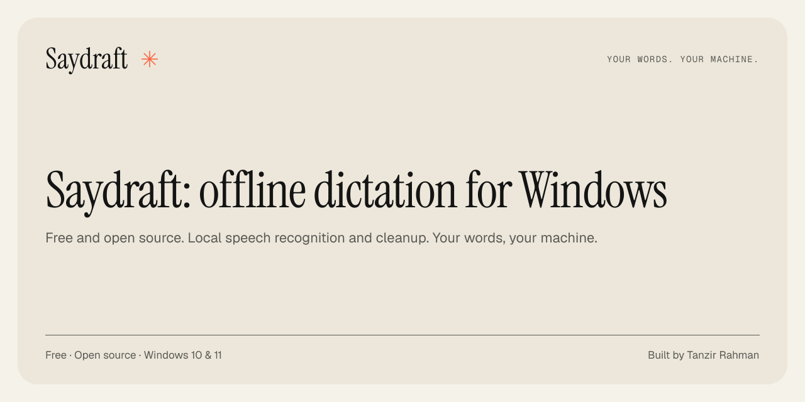

# GitHub repository presentation

These are the exact P9.6 values for `tanzir71/saydraft`, mirrored in
[`github-settings.json`](github-settings.json). G1 name and §9 visual tokens
were approved by the owner. The current GitHub Pages URL remains the website;
no domain or hosting change is part of these settings.

**Applied 2026-11-15:** the description and all 20 topics below were saved and
read back through GitHub, then verified on the repository page in the owner's
authorized browser. The homepage already matched.

**Social preview applied 2026-11-15:** the owner explicitly approved the prepared
PNG for this repository. It was uploaded through the authorized built-in browser
and remained displayed after reloading Settings. The uploaded asset's SHA-256 is
`8ad6ea81e997d70468052f32c1b7aec11e2880a5214488bb564668bba9b4ba2a`.
The [receipt and saved screenshot](../../eval/site/results/2026-11-15-social-preview/README.md)
complete this P9.6 setting; G9's separate old-site decision remains pending.

## About description

> Free, open-source offline dictation for Windows. Local Parakeet/Whisper speech-to-text and on-device AI cleanup with installed models. A private Wispr Flow / Typeless alternative. Development preview; review setup and accuracy limits.

This qualifies the plan's “any app” wording because protected/elevated fields
can refuse insertion and full physical-app acceptance remains open. It makes no
speed, accuracy, certification or complete-parity claim. Competitor names identify
the alternative category and imply no affiliation.

Website: **https://tanzir71.github.io/saydraft/**

## Topics

GitHub permits at most 20 topics, using lowercase letters, numbers and hyphens
with a 50-character maximum. These are the plan's exact 20 topics.
See [GitHub's topic guidance](https://docs.github.com/en/repositories/managing-your-repositorys-settings-and-features/customizing-your-repository/classifying-your-repository-with-topics).

```text
dictation speech-to-text voice-typing voice-to-text offline windows
wispr-flow-alternative typeless-alternative whisper parakeet local-llm llama-cpp
sherpa-onnx privacy accessibility push-to-talk transcription asr pyside6 productivity
```

## Exact CLI commands

Inspect the current values first. The edit below adds these topics and updates
only description/homepage. The initial five topics are a subset, so no topic
removal is needed. If someone adds another topic and the union exceeds 20,
review that difference before applying; do not silently remove their changes.

```powershell
gh repo view tanzir71/saydraft --json nameWithOwner,description,homepageUrl,repositoryTopics
gh repo edit tanzir71/saydraft --description 'Free, open-source offline dictation for Windows. Local Parakeet/Whisper speech-to-text and on-device AI cleanup with installed models. A private Wispr Flow / Typeless alternative. Development preview; review setup and accuracy limits.' --homepage 'https://tanzir71.github.io/saydraft/' --add-topic 'dictation,speech-to-text,voice-typing,voice-to-text,offline,windows,wispr-flow-alternative,typeless-alternative,whisper,parakeet,local-llm,llama-cpp,sherpa-onnx,privacy,accessibility,push-to-talk,transcription,asr,pyside6,productivity'
gh repo view tanzir71/saydraft --json nameWithOwner,description,homepageUrl,repositoryTopics
```

The owner's standing instruction authorizes GitHub work needed for this plan,
with local validation and direct main pushes. These reversible About fields use
that authorization. G9's separate old-site decision remains pending; these commands
do not change Pages configuration, workflows, release state or Vercel settings.

## Social preview

Upload [`assets/saydraft-github-social-preview.png`](assets/saydraft-github-social-preview.png)
under Repository → Settings → General → Social preview → Edit → Upload an image.
The file is the existing local-font OG generator's **1280×640 PNG**, 49,470 bytes,
using the approved paper/ink palette and creator credit. It is well below GitHub's
1 MB limit. Source/provenance hashes are in
[`assets/media/readme-assets.json`](../../assets/media/readme-assets.json).



GitHub documents social-preview upload through its settings UI; `gh repo edit`
has no social-image flag. See [the official upload instructions](https://docs.github.com/en/repositories/managing-your-repositorys-settings-and-features/customizing-your-repository/customizing-your-repositorys-social-media-preview).
Verify the saved custom preview on the repository afterward; an image file in
Git alone does not establish the setting. GraphQL's `usesCustomOpenGraphImage`
and `openGraphImageUrl` provide an additional read-only check.

## README and media

The README now leads with the primary terms, actual Bar GIF, unsigned-preview
download badge, migration guidance, dated source-linked comparison, FAQ and
explicit creator/model credits. Existing setup and qualification detail stays
available. The 72-frame native Qt fixture produces a 65-frame encoded GIF and
static PNG; its 5.76-second animation is illustrative, not a latency measurement.
It includes optional English live preview, labelled accordingly. The static PNG
is shown first for everyone; the looping GIF is inside an explicitly opened
native disclosure. Collapse it to hide motion. A real GitHub Markdown API check
found that automatic image-link wrapping broke the proposed `<picture>` fallback,
so this does not depend on the host preserving media-query image selection.

`tools/render_readme_bar.py` reproduces it into a fresh directory outside the
checkout using Qt offscreen, isolated profiles, fake levels/clock/geometry and
barred audio SDK, microphone, foreground, native input and clipboard access.
No model is run. Original source PNGs, frames and access flags are retained in
the repository-presentation evidence. Existing native accuracy and release gates
remain separate.
