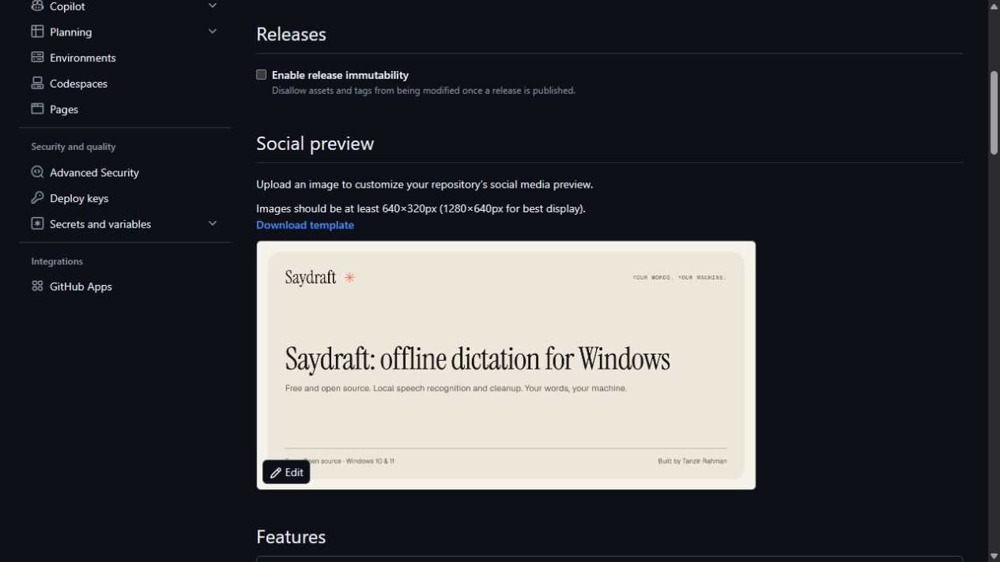

# Approved GitHub social preview — 15 November 2026

The owner explicitly approved the displayed PNG for **tanzir71/saydraft →
Settings → Social preview**. The approved 1280×640, 49,470-byte asset was uploaded
through the logged-in in-app browser's documented file chooser. The custom
Saydraft card remained visible after reloading repository Settings.

The [receipt](receipt.json) pins the exact asset and screenshot SHA-256. The
[browser observation](visible-image.json) records the settings URL and reload.
The preview has no matching DOM `img`, so no remote-image URL or GraphQL result
is claimed. The saved screenshot supplies the visible persistence evidence.

The [settings guide](../../../../docs/launch/github-settings.md) now records the
completed setting. Earlier repository-presentation receipts correctly retain
their then-default preview and pending approval. No hosting configuration,
workflow, release or old Vercel site was changed. G9 remains unanswered.

Together with the earlier verified description, twenty topics, homepage, README
and exact settings artifacts, this completes the stated P9.6 scope. Other P9,
accuracy, desktop, build and release gates remain separate. No physical desktop,
microphone, audio device or clipboard was used for this browser upload.
