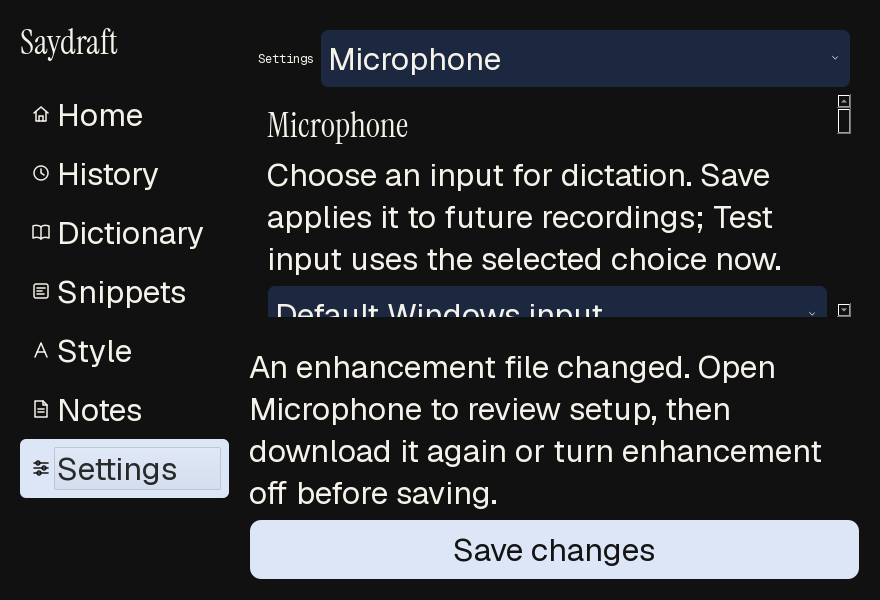

# Hub reflow and portable checkpoint — 15 November 2026

Runtime/build source **f6cd0bf7a23c6587939ae1bc56009581b1452c86** has **114** strict offscreen states, **228**
named forward/reverse Tab walks and a fresh portable. The successful related
selection is **244 passed / four app-entry integrations deselected**. The final
Hub file rerun is at QA-only source **301218a013a5a25e3e3cac6556b0f5eba2a6c0a3**; every app/build input tree
is identical. No physical Windows, owner accuracy or public-release acceptance
follows. [Remaining work and critical blockers](../../../../docs/DELIVERY_HANDOVER.md).

The [qualified selection](tests/qualified.json) points to sixteen successful
held-Job file runs and one direct-native-interpreter Hub rerun. The original
[full attempt](tests/attempt-r2/summary.json), including its failed Hub file,
remains unchanged. The focused rerun has 11 passes/one deselection and retains
the same reachability assertions, with bounded synchronization for a queued
footer/viewport resize. Its direct process exit is recorded separately from
the sixteen whole-Job exits; it is not relabelled as a Job-tree observation.

## UI scope

Native multiline controls preserve source labels, accessible names and input
behavior. Rows/History reflow, language selectors shrink, the Command heading
wraps, and Style columns retain full choices with table-only horizontal scroll.
Live themed fonts propagate to existing controls. Long setup feedback can stack
above Save. [Current behavior](../../../../docs/HUB_ACCESSIBILITY.md).

The [render report](final/report.json) covers 18 ordinary/expanded views plus
the long-warning state, in light/dark/injected high contrast at actual 16/32px
text. It checks actual control fonts, height, zero page horizontal overflow and
named Tab cycles. The tests additionally cover both 880×600 and 1080×720 and
keyboard focus scrolling. Display density is 1×; physical/mixed-DPI/Narrator and
complete gallery acceptance remain open. The Labs dark native-blue license-link
contrast issue is explicitly recorded in the handover.



## Portable scope

[Bundle audit](package/bundle.json), [runtime audit](package/runtime.json),
[frozen-code comparison](package/frozen-source.json) and
[ZIP verification](package/artifact-verification.json) qualify the local portable:
157,078,375 bytes, SHA-256 `3577ab3daf5af400b441dc0fb32d4c604cd1956d9f2522d763d0b1469ea8e78f`. All 1,384 ZIP payloads
match the audited bundle. Notices cover 40 components/511 files. Sixteen changed
runtime modules read from the actual EXE's embedded PYZ structurally match Git
source bytecode; module code is not executed by that check.

The build used `-SkipInstaller`. Installer/signing/packaging release gates remain
false. The runtime audit opens no microphone/device/clipboard/foreground/input,
performs no ASR and makes no native-firewall claim. This is a development preview.
The earlier successful package at 0d45 predates the footer correction and remains
classified as superseded, with its own immutable source and receipts.

## Original failures

The first small control test had unregistered fonts. The first reflow-specific
checks exposed live fonts staying small; the native before/after probes retain
that failure and Qt propagation result. The 0d45 broad run found missing font
registration in a test, a 500ms scheduling wait for owned History, and a real
clipped setup-warning footer. The final footer has six 16/32px/theme cases and
the earlier 22px regression. Original logs are retained under diagnostics.

The f6cd broad attempt then exposed an existing one-event-turn scroll assertion
running before a queued footer resize. Only that fixture was changed; all app
and build inputs stay identical, and its full file rerun passes. Production
inference deadlines, assertions and acceptance thresholds are unchanged.

The first archive-reader helper was barred from loading unrelated credential
DLL bindings in PyInstaller's root initializer. The final check uses only the
pure archive readers while the owner-I/O guard stays intact. No credential or
app module code was executed. Dirty-source images/reports are diagnostic only.
No private profile, model or audio payload is retained here.

Verify historical evidence; add `--check-current` to bind current app/QA inputs:

```powershell
python eval/ui/results/2026-11-15-hub-reflow/scripts/verify-delivery.py.txt --repo . --check-current
```

Add `--build-root D:/Saydraft-Codex-QA-20261112-01a1cbc7/hub-reflow-package-20261115-r2`
on the original machine to reread every actual bundle file and ZIP hash.
